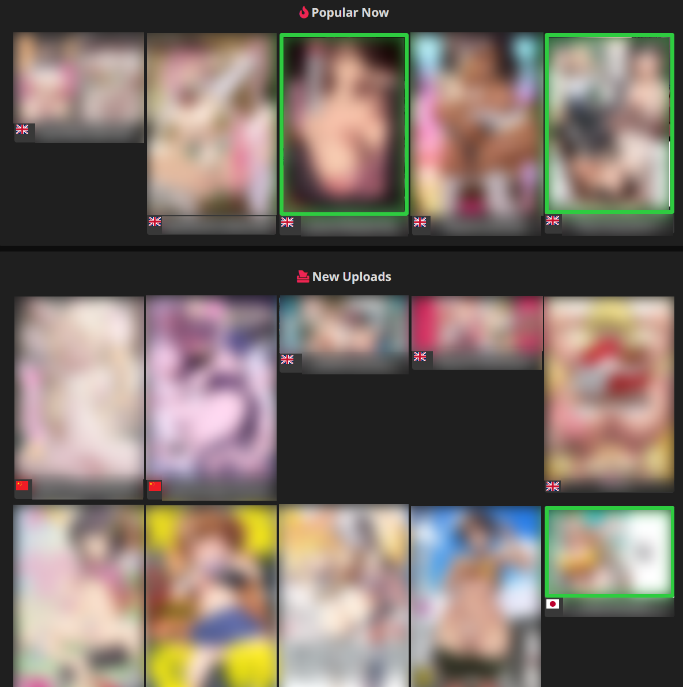
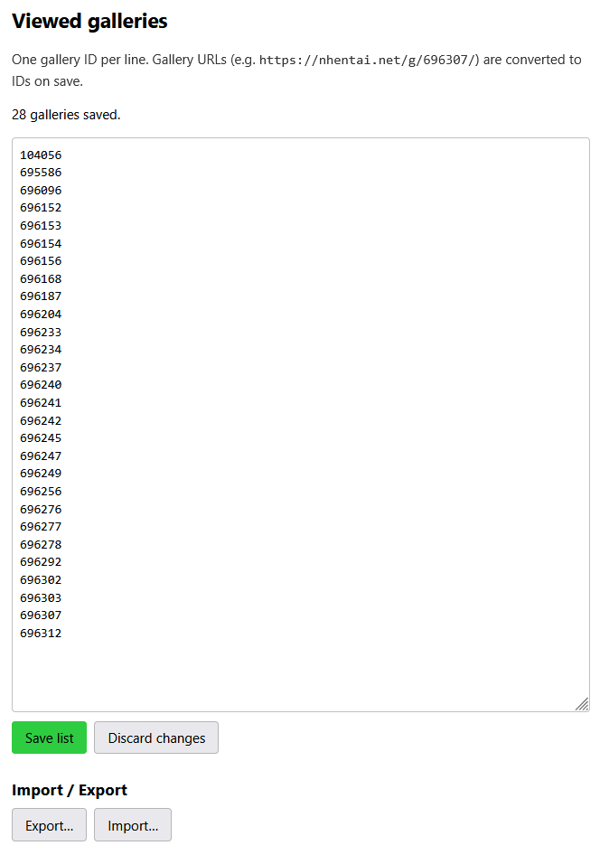

# Read Marker for nHentai

A Firefox extension that remembers which galleries you opened on [nhentai.net](https://nhentai.net) and puts a **green frame** around their thumbnails, so you can see what you have already viewed.

> **Adult content:** nhentai.net hosts sexually explicit material and is intended for adults (18+) only. Hence the blurring in the screenshots. Use this extension only where viewing such content is legal for you.
> **Disclaimer:** This project is not affiliated with, endorsed by, or connected to nhentai.

- Opening a gallery (e.g. `https://nhentai.net/g/696307/`) saves its ID (`696307`).
- Thumbnails of saved galleries get a green frame on all list pages (home, search, tags, …).
- The gallery you are currently viewing is never framed.

## Managing the list
Click the toolbar button (or *Add-ons → Read Marker for nHentai → Options*) to open the list:

- **Edit:** one gallery ID per line (numbers without leading zeros). Add, remove or paste complete gallery URLs, then *Save changes*.
- **Backup Export:** saves the list as a `.json` file.
- **Backup Import:** loads a `.json` export or a text file with one ID/URL per line. **Import overwrites the current list** (you are asked to confirm).

## Install
Get it from [addons.mozilla.org](https://addons.mozilla.org/firefox/addon/read-marker-for-nhentai/). Requires Firefox 140 or newer.

## Install (local testing)
1. Build the package: `python build.py` → creates `dist/read-marker-for-nhentai-<version>.xpi`
2. In Firefox open `about:debugging#/runtime/this-firefox` → **Load Temporary Add-on…** → select the `.xpi` (or `src/manifest.json`).

Temporary add-ons are removed when Firefox restarts. Permanent installation requires a version signed by Mozilla.

**Development:** open the folder in VS Code → *Reopen in Container*. Then `npm run lint`, `npm run build`, or `npm start` (Firefox with the extension, shown at http://localhost:6080, password `vscode`).

## Privacy
- No usage data is tracked, except the IDs of galleries you viewed. They are saved locally in your Firefox profile (`browser.storage.local`).
- Removing the extension will also delete the gallery list. Back it up (Backup Export) if required.
- Only works with `https://nhentai.net`.

## AI tooling
This extension was created with the help of AI tools.

## License
Licensed under the GNU Affero General Public License v3.0. See [LICENSE](LICENSE).